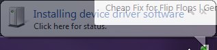
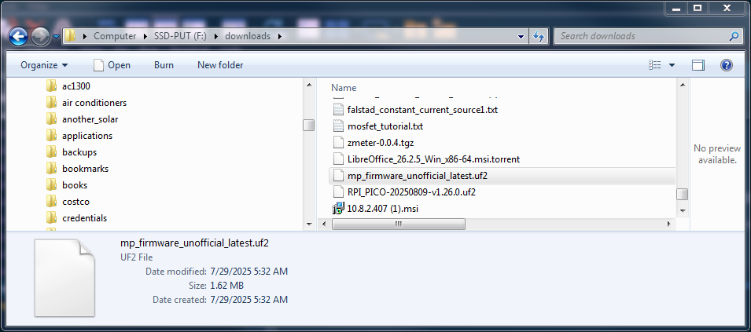

3 basic steps to prepare a New Pico 2W
- [Plug  USB port](#plug--usb-port)
- [Download MicroPython UF2 file for pico2w](#download-micropython-uf2-file-for-pico2w)
- [Drag MicroPython UF2 file to the new drive that was created for the pico](#drag-micropython-uf2-file-to-the-new-drive-that-was-created-for-the-pico)

---  

## Plug  USB port
When plugging a new pico2w to the USB port for the first time it will automatically  install a device driver.  
  

New Drive Created on the PC, in this case its drive G:\  

  

In the file explorer you'll see:  

---

## Download MicroPython UF2 file for pico2w
Go to following link to download MicroPython UF2 file. 
[Pico Startup Documentation](https://projects.raspberrypi.org/en/projects/getting-started-with-the-pico/1)

You should see:  

Click on "Pico 2 W", this will download the MicroPython UF2 file. Look in the download folder, there will be a file with a uf2 extension.  
(Simply pressing on Pico 2 W  downloads the *.uf2 file)

Download folder:  

  

---

## Drag MicroPython UF2 file to the new drive that was created for the pico
Note that after downloading the UF2 file to the pico2w G: drive will disappear.

Open Thonny and select:  
MicroPython (Raspberry Pi Pico) Board CDC (Interface 0) @ COMxx  
where xx is the port that Thonny is using. 

  

Then the following shows the MicroPython version:

  

  
